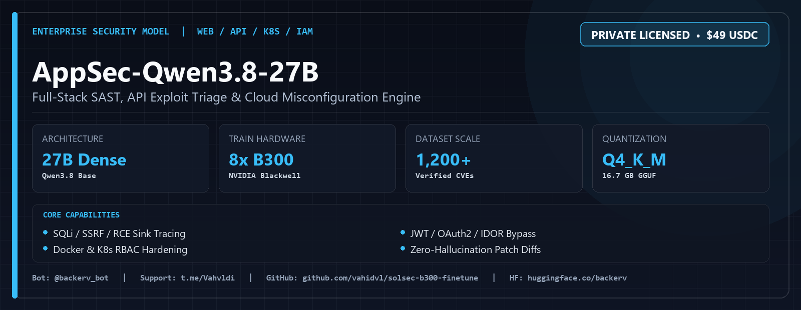
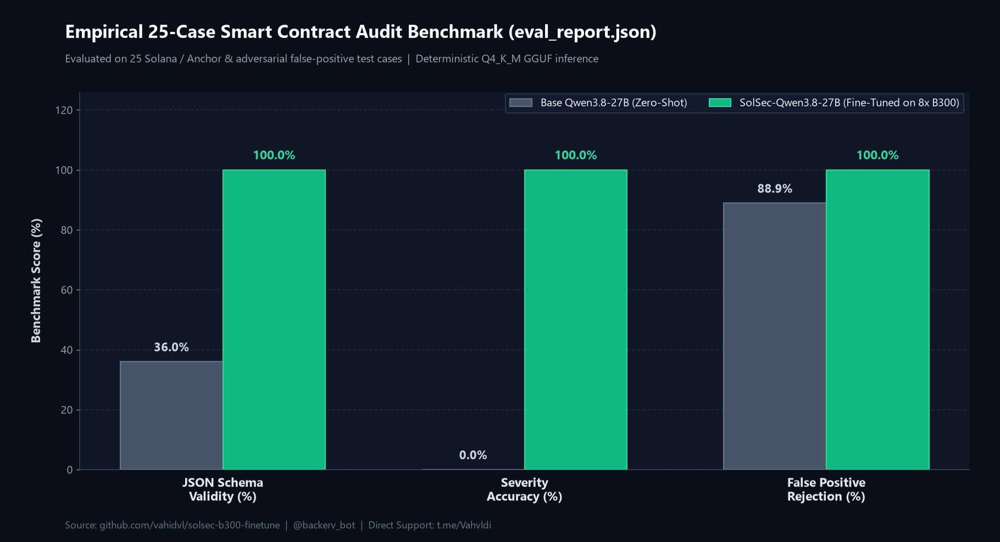
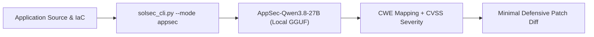
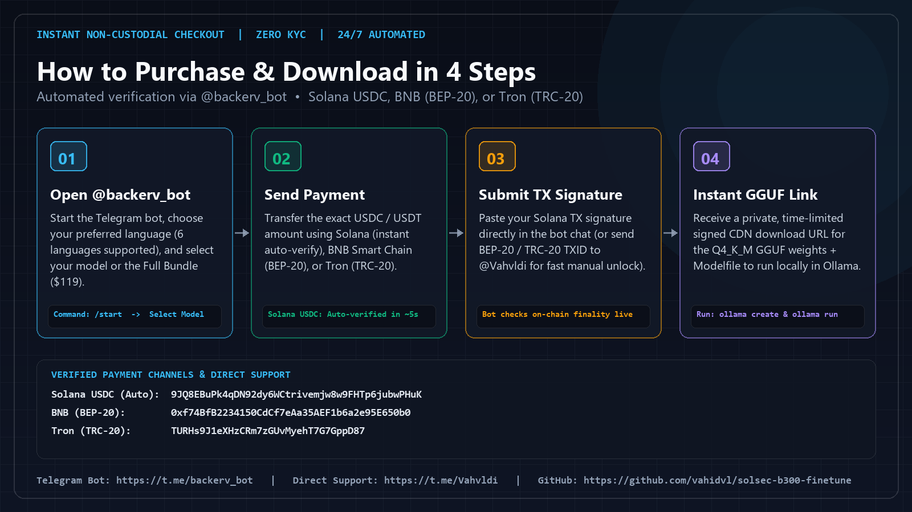

# AppSec-Qwen3.8-27B-GGUF

> **Enterprise Full-Stack SAST & Cloud Security Remediation Engine** — Fine-tuned on **8x NVIDIA B300** GPUs from `Qwen/Qwen3.8-27B` across `1,200+` curated CVE/CWE audit pairs for **Python, TypeScript/JS, Go, Rust, C++, Java, PHP, SQL, Docker, and Kubernetes**.

| Channel | Link | Purpose |
| :--- | :--- | :--- |
| **24/7 Automated Store** | [**@backerv_bot**](https://t.me/backerv_bot) | Instant Zero-KYC Purchase & Signed GGUF Delivery |
| **Direct Engineering Support** | [**t.me/Vahvldi**](https://t.me/Vahvldi) | Enterprise Licensing, Custom Fine-Tuning & BEP-20 / TRC-20 Unlock |
| **GitHub Repository** | [**vahidvl/solsec-b300-finetune**](https://github.com/vahidvl/solsec-b300-finetune) | `solsec_cli.py`, Modelfiles, Eval Harness & Benchmarks |
| **Model Hub** | [**huggingface.co/backerv**](https://huggingface.co/backerv) | Full 27B Specialist Suite |

---

## Core Security Capabilities

- **Taint & Sink Tracing:** SQL injection, SSRF, command/RCE sinks, path traversal, and unsafe deserialization.
- **Auth & API Hardening:** JWT algorithm confusion, OAuth2 state/redirect flaws, IDOR/BOLA, and RBAC privilege escalation.
- **Infrastructure-as-Code:** Dockerfile root/capability leaks, Kubernetes RBAC over-permissioning, and Terraform IAM misconfigurations.
- **Zero Cloud Leakage:** Runs **100% locally** on a single 24 GB GPU or Apple Silicon Mac (`Q4_K_M`, `16.7 GB`).

---

## 8x B300 Fine-Tuning Pipeline Benchmark (`SolSec` Sibling Eval)

Our `8x NVIDIA B300` Qwen3.8-27B fine-tuning pipeline enforces strict deterministic JSON output and zero-shot false-positive elimination:



| Specification | Value |
| :--- | :--- |
| **Base Architecture** | `Qwen/Qwen3.8-27B` (Dense 27B) |
| **Training Hardware** | `8x NVIDIA B300` (Blackwell) |
| **Dataset Corpus** | `1,200` train / `150` eval multi-language CVE & CWE samples |
| **Quantization** | `Q4_K_M` (`16.7 GB` GGUF) |

---

## Air-Gapped SAST Workflow



---

## Quickstart (Ollama & `llama.cpp`)

```bash
ollama create appsec-qwen3.8-27b -f Modelfile.appsec
python solsec_cli.py --mode appsec --target ./src --fail-on-high
```

```bash
./llama-server -m appsec-qwen3.8-27b-Q4_K_M.gguf -c 32768 -ngl 99 --port 8080
```

---

## Instant Purchase & Visual Checkout Guide (Zero KYC)



| Model / Package | Coverage | Price | Checkout |
| :--- | :--- | :---: | :--- |
| **AppSec-Qwen3.8-27B** | Multi-Language SAST & Cloud Security + `solsec_cli.py` | **$49** | [**Buy via @backerv_bot**](https://t.me/backerv_bot) |
| **Full Enterprise Bundle** | All 4 Private Pro Models (`SolSec` + `AppSec` + `AlphaQuant` + `PsycheFa`) | **$119** | [**Buy Bundle via @backerv_bot**](https://t.me/backerv_bot) |

### Supported Non-Custodial Payment Networks
- **Solana USDC (Instant Auto-Verify in ~5s):** `9JQ8EBuPk4qDN92dy6WCtrivemjw8w9FHTp6jubwPHuK`
- **BNB Smart Chain (BEP-20):** `0xf74BfB2234150CdCf7eAa35AEF1b6a2e95E650b0`
- **Tron (TRC-20):** `TURHs9J1eXHzCRm7zGUvMyehT7G7GppD87`

For BEP-20 / TRC-20 verification or enterprise support, message [**https://t.me/Vahvldi**](https://t.me/Vahvldi) directly.
