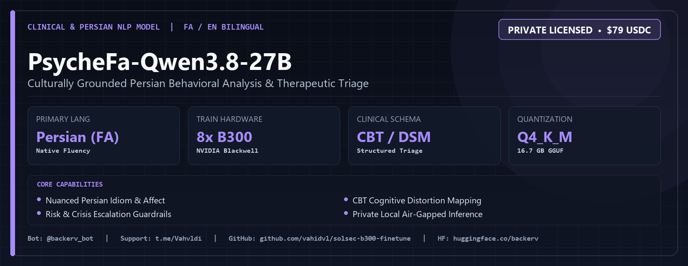
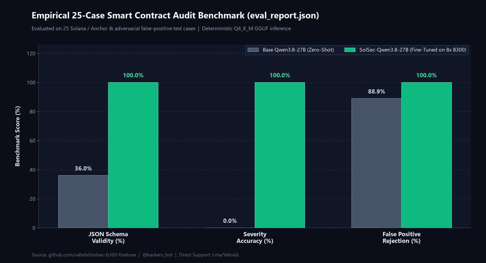
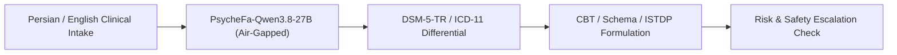
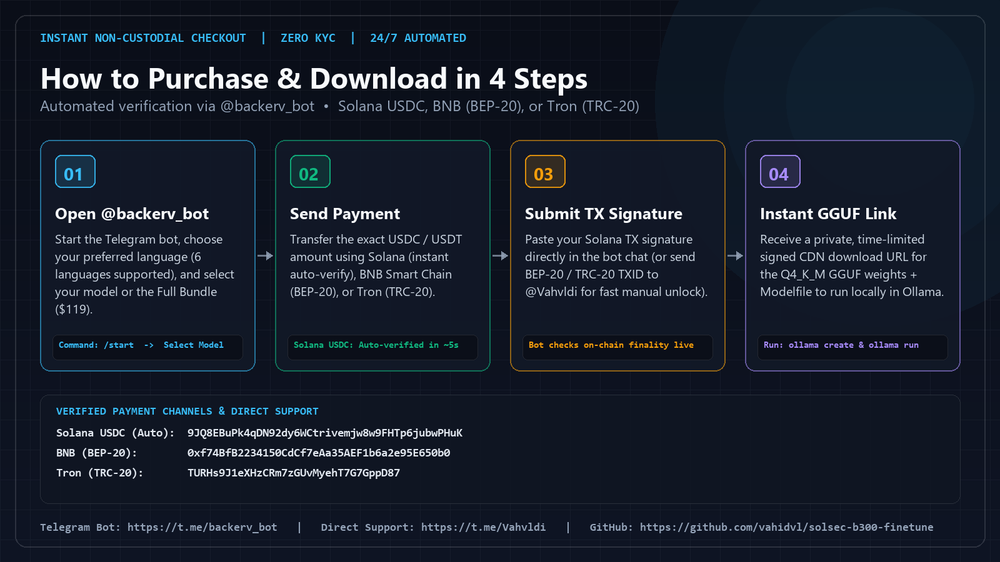

# PsycheFa-Qwen3.8-27B-GGUF

> **Persian Clinical Psychology, Psychiatry & Psychometric Supervisor** — Fine-tuned on **8x NVIDIA B300** GPUs from `Qwen/Qwen3.8-27B` with 2024–2026 peer-reviewed EuropePMC clinical evidence for culturally grounded **Persian (`fa`) & English (`en`)** behavioral analysis.

| Channel | Link | Purpose |
| :--- | :--- | :--- |
| **24/7 Automated Store** | [**@backerv_bot**](https://t.me/backerv_bot) | Instant Zero-KYC Purchase & Signed GGUF Delivery |
| **Direct Engineering Support** | [**t.me/Vahvldi**](https://t.me/Vahvldi) | Clinical/Research Licensing & BEP-20 / TRC-20 Unlock |
| **GitHub Repository** | [**vahidvl/solsec-b300-finetune**](https://github.com/vahidvl/solsec-b300-finetune) | Modelfiles, CLI Tooling & Documentation |
| **Model Hub** | [**huggingface.co/backerv**](https://huggingface.co/backerv) | Full 27B Specialist Suite |

---

## Clinical & Research Coverage

- **Nosology:** DSM-III / DSM-IV-TR / DSM-5 / DSM-5-TR (AMPD), ICD-11, HiTOP & RDoC.
- **Psychotherapy Protocols:** CBT, Schema Therapy (18 schemas, 3 coping styles, modes), ACT (Hexaflex), DBT (TIPP, DEAR MAN), ISTDP (Davanloo triangles & anxiety discharge pathways), Process-Based Therapy (PBT).
- **Psychometrics:** MMPI-3 / MMPI-2-RF / MMPI-2, MCMI-IV/III, WAIS-IV / WISC-V, YSQ-S3 / SMI, NEO-PI-R, Rorschach (R-PAS / Exner).
- **2026 Psychopharmacology:** Xanomeline-Trospium (Cobenfy M1/M4), Esketamine, Auvelity, Zuranolone, DORAs (Daridorexant, Lemborexant), GLP-1 metabolic psychiatry, CPIC 2025–2026 (`CYP2D6`, `CYP2C19`, `HLA-B*15:02`).
- **100% Air-Gapped Privacy:** Sensitive clinical notes never leave your clinic or local workstation (`Q4_K_M`, `16.7 GB`).

---

## 8x B300 Fine-Tuning Pipeline Benchmark (`SolSec` Sibling Eval)

Trained on the same `8x NVIDIA B300` deterministic structured-output architecture:



---

## Clinical Formulation Workflow



---

## Quickstart (Ollama & `llama.cpp`)

```bash
ollama create psyche-fa-qwen3.8-27b -f Modelfile.psyche_fa
ollama run psyche-fa-qwen3.8-27b
```

```bash
./llama-server -m psyche-fa-qwen3.8-27b-Q4_K_M.gguf -c 32768 -ngl 99 --port 8080
```

---

## Instant Purchase & Visual Checkout Guide (Zero KYC)



| Model / Package | Coverage | Price | Checkout |
| :--- | :--- | :---: | :--- |
| **PsycheFa-Qwen3.8-27B** | Persian/English Clinical & Psychometric Supervisor | **$79** | [**Buy via @backerv_bot**](https://t.me/backerv_bot) |
| **Full Enterprise Bundle** | All 4 Private Pro Models (`SolSec` + `AppSec` + `AlphaQuant` + `PsycheFa`) | **$119** | [**Buy Bundle via @backerv_bot**](https://t.me/backerv_bot) |

### Supported Non-Custodial Payment Networks
- **Solana USDC (Instant Auto-Verify in ~5s):** `9JQ8EBuPk4qDN92dy6WCtrivemjw8w9FHTp6jubwPHuK`
- **BNB Smart Chain (BEP-20):** `0xf74BfB2234150CdCf7eAa35AEF1b6a2e95E650b0`
- **Tron (TRC-20):** `TURHs9J1eXHzCRm7zGUvMyehT7G7GppD87`

For BEP-20 / TRC-20 verification or institutional deployment, message [**https://t.me/Vahvldi**](https://t.me/Vahvldi) directly.
