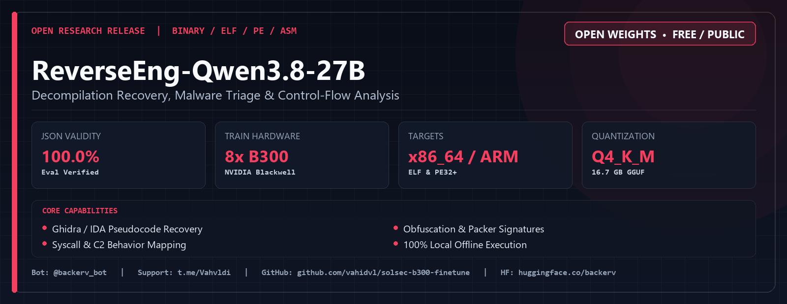
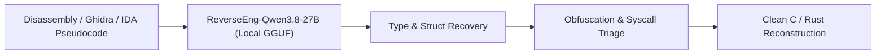
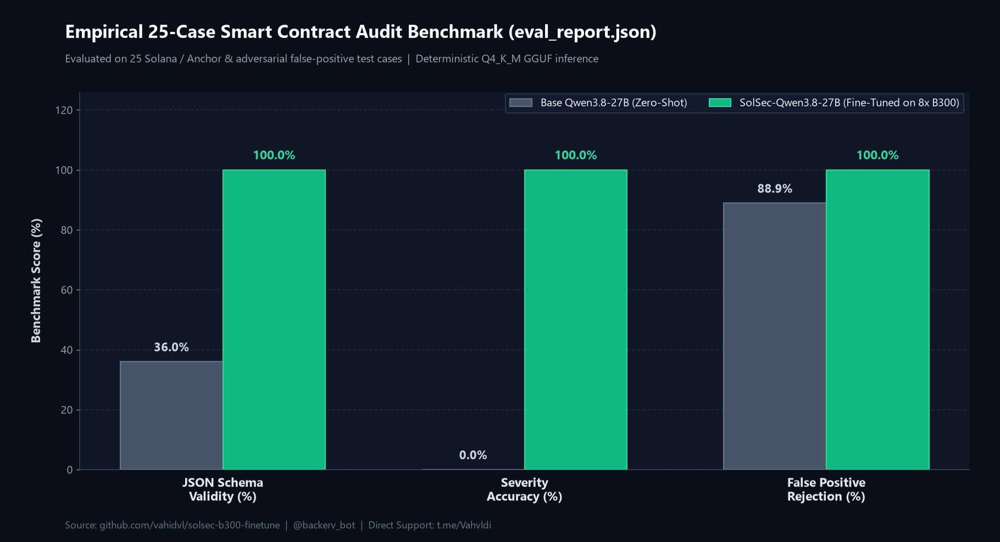
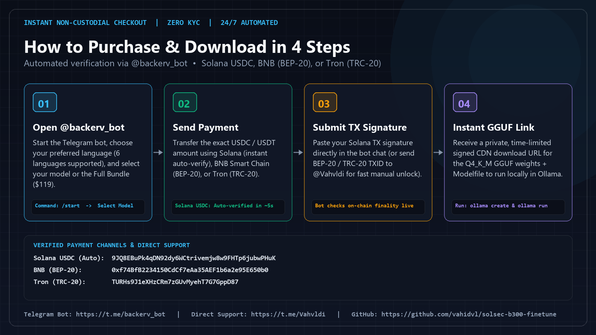

# ReverseEng-Qwen3.8-27B-GGUF

> **Open-Weights 27B Binary Reverse Engineering & Decompilation Specialist (262K Context)** — Fine-tuned on **8x NVIDIA B300** GPUs from `Qwen/Qwen3.8-27B` for `x86_64` & `ARM64` assembly-to-C/Rust decompilation, Ghidra/IDA Pro pseudocode recovery, struct/type inference, and static malware/anti-debug triage.

| Channel | Link | Purpose |
| :--- | :--- | :--- |
| **24/7 Automated Pro Store** | [**@backerv_bot**](https://t.me/backerv_bot) | Upgrade to Private Pro Models (`SolSec`, `AppSec`, `AlphaQuant`, `PsycheFa`) |
| **Direct Engineering Support** | [**t.me/Vahvldi**](https://t.me/Vahvldi) | Enterprise Licensing, Custom Fine-Tuning & Support |
| **GitHub Repository** | [**vahidvl/solsec-b300-finetune**](https://github.com/vahidvl/solsec-b300-finetune) | `solsec_cli.py`, Modelfiles, Eval Harness & Benchmarks |
| **Model Hub** | [**huggingface.co/backerv**](https://huggingface.co/backerv) | Full 27B Specialist Suite |

Runs **100% locally** on a single 24 GB GPU (`RTX 3090 / 4090`) or `24 GB+` Apple Silicon Mac (`Q4_K_M`, `16.7 GB`) with zero cloud API leakage.

---

## Reverse Engineering Workflow



---

## Quickstart (Ollama & `llama.cpp`)

```bash
huggingface-cli download backerv/ReverseEng-Qwen3.8-27B-GGUF reverseeng-qwen3.8-27b-Q4_K_M.gguf Modelfile.reverseeng --local-dir .
ollama create reverseeng-27b -f Modelfile.reverseeng
ollama run reverseeng-27b
```

```bash
./llama-server -m reverseeng-qwen3.8-27b-Q4_K_M.gguf -c 32768 -ngl 99 --port 8080
```

---

## Commercial Pro Model Suite (8x B300 Fine-Tuned `Qwen3.8-27B` Collection)

`ReverseEng-Qwen3.8-27B-GGUF` is the free open release from our **27B Air-Gapped Specialist Suite**. Unlock the private commercial models with full CLI tooling and structured JSON audit pipelines:

| Model | Domain & Capabilities | Training Corpus | Price |
| :--- | :--- | :--- | :---: |
| **ReverseEng-Qwen3.8-27B** | `x86_64` / `ARM64` decompilation, Ghidra/IDA cleanup, ELF/PE static analysis | `1,200` train / `150` eval | **FREE (Public)** |
| **SolSec-Qwen3.8-27B** | Smart-contract security auditor (`Solidity` + `Solana Rust/Anchor`), PoC exploits, patches | `1,062` train / `117` eval | **$49** |
| **AppSec-Qwen3.8-27B** | Multi-language SAST & defensive patching (`Python`, `TS/JS`, `Go`, `Rust`, `C++`, `Java`, `SQL`) | `1,200` train / `150` eval | **$49** |
| **AlphaQuant-Qwen3.8-27B** | Quant strategies (`Freqtrade`, `PineScript`, `vectorbt`), risk engines, backtest audit | `1,200` train / `150` eval | **$49** |
| **PsycheFa-Qwen3.8-27B** | Persian/English Clinical Psychology, Psychiatry & Psychometric Supervisor | 2024–2026 EuropePMC | **$79** |
| **Full Enterprise Bundle** | **All 4 Private Pro Models** (`Q4_K_M` GGUFs + `Modelfiles` + `solsec_cli.py`) | Full Suite | **$119** |

---

## Verified Benchmark Highlight (`SolSec-Qwen3.8-27B` vs. Base `Qwen3.8-27B`)



| Metric | Base `Qwen3.8-27B` | Fine-Tuned `SolSec-Qwen3.8-27B` |
| :--- | :---: | :---: |
| **Structured JSON Validity** | `36.0%` | **`100.0%`** |
| **Severity Classification Accuracy** | `0.0%` | **`100.0%`** |
| **False-Positive Rejection Rate** | `88.9%` | **`100.0%`** |

---

## Instant Automated Purchase (24/7 Telegram Bot — Zero KYC)



Order via [**@backerv_bot**](https://t.me/backerv_bot) using:
- **Solana USDC (Instant Auto-Verify):** `9JQ8EBuPk4qDN92dy6WCtrivemjw8w9FHTp6jubwPHuK`
- **BNB Smart Chain (BEP-20):** `0xf74BfB2234150CdCf7eAa35AEF1b6a2e95E650b0`
- **Tron (TRC-20):** `TURHs9J1eXHzCRm7zGUvMyehT7G7GppD87`

Direct Support: [**https://t.me/Vahvldi**](https://t.me/Vahvldi) | GitHub: [**https://github.com/vahidvl/solsec-b300-finetune**](https://github.com/vahidvl/solsec-b300-finetune)
