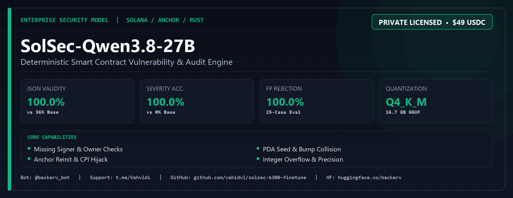
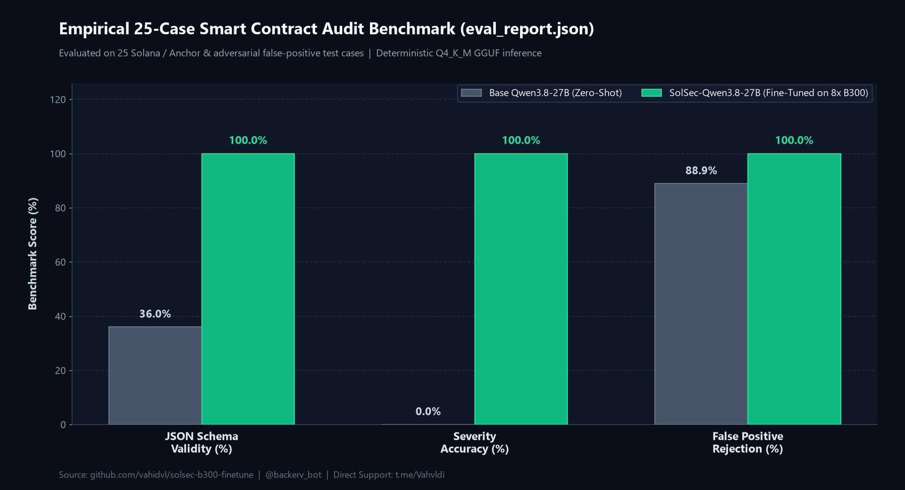
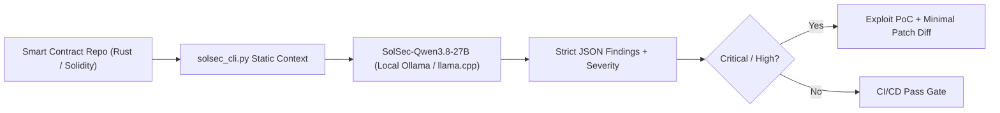
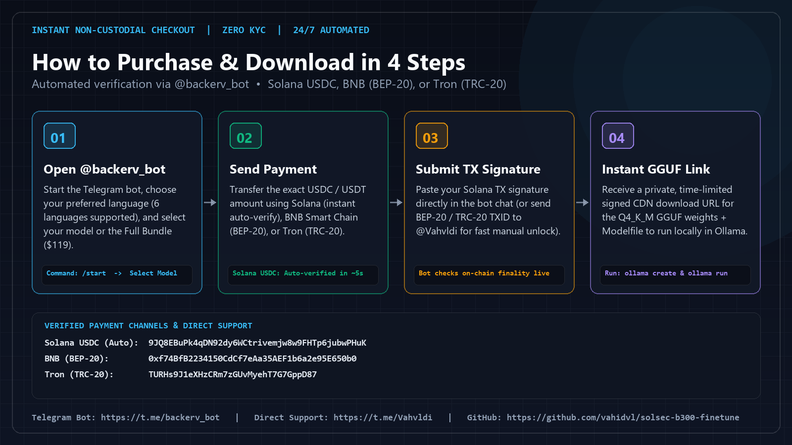

# SolSec-Qwen3.8-27B-GGUF

> **Enterprise Air-Gapped Web3 Smart Contract Security Auditor** — Fine-tuned on **8x NVIDIA B300** GPUs from `Qwen/Qwen3.8-27B` for deterministic vulnerability discovery, exploit PoC synthesis, and patch generation across **Solana (Rust/Anchor)** and **EVM (Solidity)**.

| Channel | Link | Purpose |
| :--- | :--- | :--- |
| **24/7 Automated Store** | [**@backerv_bot**](https://t.me/backerv_bot) | Instant Zero-KYC Purchase & Signed GGUF Delivery |
| **Direct Engineering Support** | [**t.me/Vahvldi**](https://t.me/Vahvldi) | Enterprise Licensing, Custom Fine-Tuning & BEP-20 / TRC-20 Unlock |
| **GitHub Repository** | [**vahidvl/solsec-b300-finetune**](https://github.com/vahidvl/solsec-b300-finetune) | `solsec_cli.py`, Modelfiles, Eval Harness & Benchmarks |
| **Model Hub** | [**huggingface.co/backerv**](https://huggingface.co/backerv) | Full 27B Specialist Suite |

---

## Core Audit Capabilities

- **Solana / Anchor / Rust:** Missing signer & owner checks, PDA seed & bump collisions, arbitrary CPI hijacking, account reinitialization, type cosplay, and integer precision loss.
- **EVM / Solidity:** Reentrancy (cross-function & read-only), flash-loan oracle manipulation, access-control bypass, storage collision, and unchecked external calls.
- **Zero Cloud Leakage:** Runs **100% locally** on a single 24 GB GPU (`RTX 3090 / 4090`) or `24 GB+` Apple Silicon Mac (`Q4_K_M`, `16.7 GB`).

---

## Empirical 25-Case Benchmark (`eval_report.json`)

Evaluated on a held-out 25-case Solana/Anchor vulnerability and adversarial false-positive suite:



| Metric | Base (`Qwen3.8-27B` Zero-Shot) | Fine-Tuned (`SolSec-Qwen3.8-27B`) | Delta |
| :--- | :---: | :---: | :---: |
| **JSON Schema Validity** | `36.0%` | **`100.0%`** | `+64.0%` |
| **Severity Classification Accuracy** | `0.0%` | **`100.0%`** | `+100.0%` |
| **False-Positive Rejection Rate** | `88.9%` | **`100.0%`** | `+11.1%` |

---

## Air-Gapped Audit Pipeline



---

## Quickstart (Ollama & `llama.cpp`)

```bash
# 1. Create the local Ollama model from the included Modelfile
ollama create solsec-qwen3.8-27b -f Modelfile.solsec

# 2. Run automated CI/CD repository audit
python solsec_cli.py --mode solsec --target ./contracts --fail-on-high
```

```bash
# Or serve directly via llama.cpp (24GB+ VRAM)
./llama-server -m solsec-qwen3.8-27b-Q4_K_M.gguf -c 32768 -ngl 99 --port 8080
```

---

## Instant Purchase & Visual Checkout Guide (Zero KYC)



| Model / Package | Coverage | Price | Checkout |
| :--- | :--- | :---: | :--- |
| **SolSec-Qwen3.8-27B** | Solana/Anchor & Solidity Auditor + `solsec_cli.py` | **$49** | [**Buy via @backerv_bot**](https://t.me/backerv_bot) |
| **Full Enterprise Bundle** | All 4 Private Pro Models (`SolSec` + `AppSec` + `AlphaQuant` + `PsycheFa`) | **$119** | [**Buy Bundle via @backerv_bot**](https://t.me/backerv_bot) |

### Supported Non-Custodial Payment Networks
- **Solana USDC (Instant Auto-Verify in ~5s):** `9JQ8EBuPk4qDN92dy6WCtrivemjw8w9FHTp6jubwPHuK`
- **BNB Smart Chain (BEP-20):** `0xf74BfB2234150CdCf7eAa35AEF1b6a2e95E650b0`
- **Tron (TRC-20):** `TURHs9J1eXHzCRm7zGUvMyehT7G7GppD87`

For BEP-20 / TRC-20 verification, enterprise volume licensing, or technical questions, message [**https://t.me/Vahvldi**](https://t.me/Vahvldi) directly.
